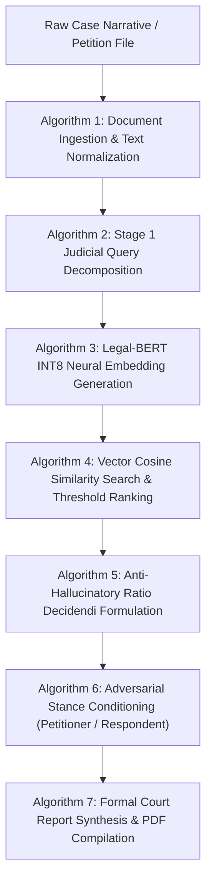

# LAW-AI: Implemented Algorithms, Mathematical Formulations & Methodology
## B.Tech Minor Project Technical Documentation — Chapter 5: Algorithms & Methodology
**Department of Computer Science & Engineering | GIET University Guidelines Compliant**

---

### 5.1 Overview of Implemented Algorithmic Pipeline

LAW-AI implements a deterministic, multi-stage legal intelligence pipeline combining dense vector space transformations, cosine similarity ranking, transformer-based neural tokenization, constrained LLM schema generation, and cryptographic hashing algorithms.



---

### 5.2 Algorithm 1: Legal Document Ingestion & Sanitization
* **Implementation Status:** **Fully Implemented**
* **Source Location:** [`app/services/document_parser.py:DocumentParserService.extract_text()`](file:///d:/PrescendenceRAG/app/services/document_parser.py#L16-L108)
* **Purpose:** Safely ingest and normalize multi-page PDF/TXT petitions while protecting against malicious binaries and memory exhaustion attacks.

#### Algorithmic Steps:
1. **Size Boundary Verification:** Read up to $10 \text{ MB} + 1 \text{ Byte}$ from the upload stream. If $\text{length} > 10 \text{ MB}$, terminate with HTTP 413 (Payload Too Large).
2. **Magic Byte Header Inspection:** Verify that the first 5 bytes match the standard PDF header specification:
   $$\text{file\_bytes}[0:5] == \text{b"\%PDF-"}$$
   If mismatched, raise HTTP 422 (Unprocessable Entity).
3. **Page Iteration & Extraction:** Initialize PyMuPDF (`fitz.open(stream=..., filetype="pdf")`). Loop across pages from $0$ up to $\min(\text{page\_count}, 35)$:
   $$\text{raw\_text}_p = \text{page}_p.\text{get\_text}()$$
4. **Whitespace & Control Character Sanitization:** Apply regular expressions to normalize continuous whitespace, tab stops, and newline breaks:
   $$\text{clean\_text} = \text{regex\_replace}(\text{r"\s+", " ", raw\_text})$$
5. **Context Aggregation:** Concatenate lawyer summary text with extracted document pages.

---

### 5.3 Algorithm 2: Stage 1 Judicial Query Decomposition
* **Implementation Status:** **Fully Implemented**
* **Source Location:** [`app/services/query_generator.py:QueryGeneratorService.generate_queries_and_facts()`](file:///d:/PrescendenceRAG/app/services/query_generator.py#L37-L75)
* **Purpose:** Deconstruct unstructured case narratives into legally operative facts, applicable statutory provisions, and 4–5 concept-dense semantic search queries.

#### Algorithmic Steps:
1. **Context Window Slicing:** Slice normalized text to $12,000$ characters to prevent LLM context saturation:
   $$\text{input\_text} = \text{case\_text}[:12000]$$
2. **Constrained Schema Prompting:** Construct prompt with `STAGE1_SYSTEM_PROMPT` instructing the model to act as a Supreme Court Research Clerk.
3. **Execution with Fallback:** Execute Groq completion with `response_format={"type": "json_object"}`. If API failure occurs, execute `_fallback_formulation()`:
   - Extract legal keywords via regex matching against statutory patterns (e.g., `Section \d+`, `Article \d+`, `FIR No.`).
   - Generate heuristic queries directly from client facts.
4. **Validation:** Ensure exactly 4 to 5 non-empty search queries are returned.

---

### 5.4 Algorithm 3: Legal-BERT INT8 Neural Embedding Generation
* **Implementation Status:** **Fully Implemented**
* **Source Location:** [`app/services/vector_engine.py:VectorEngine._encode_onnx()`](file:///d:/PrescendenceRAG/app/services/vector_engine.py#L141-L158)
* **Purpose:** Transform textual queries into dense 768-dimensional semantic representations using an optimized INT8-quantized Legal-BERT model in ~18ms.

#### Mathematical Formulation:
Given an input token sequence $T = (t_1, t_2, \dots, t_L)$ where $L \le 256$, the model computes token representations via 12 Transformer encoder layers:
$$\mathbf{H} = \text{BERT}(T) \in \mathbb{R}^{L \times 768}$$
To obtain a single fixed-size embedding vector $\mathbf{e}$, mean pooling is applied over all non-padding tokens utilizing attention mask $m_i \in \{0, 1\}$:
$$\mathbf{e} = \frac{\sum_{i=1}^L m_i \cdot \mathbf{h}_i}{\sum_{i=1}^L m_i}$$
The vector is subsequently normalized onto the unit hypersphere ($L_2$ normalization):
$$\mathbf{\hat{e}} = \frac{\mathbf{e}}{\|\mathbf{e}\|_2} = \frac{\mathbf{e}}{\sqrt{\sum_{k=1}^{768} e_k^2}}$$

#### Algorithmic Steps:
1. Tokenize query text using `BertTokenizerFast` with parameters: `padding=True`, `truncation=True`, `max_length=256`.
2. Convert token outputs (`input_ids`, `attention_mask`, `token_type_ids`) to `int64` NumPy tensors.
3. Pass tensors to the ONNX Runtime `InferenceSession` with `CPUExecutionProvider` configured for 2 intra-op threads.
4. Extract the 768-dimensional embedding vector $\mathbf{\hat{e}} \in \mathbb{R}^{768}$.

---

### 5.5 Algorithm 4: Vector Cosine Similarity Search & Ranking
* **Implementation Status:** **Fully Implemented**
* **Source Location:** [`app/services/vector_engine.py:VectorEngine.search_precedents()`](file:///d:/PrescendenceRAG/app/services/vector_engine.py#L210-L290)
* **Purpose:** Retrieve the most semantically relevant judgment chunks from the 76,802 Supreme Court vector database.

#### Mathematical Formulation:
The similarity between query vector $\mathbf{q} \in \mathbb{R}^{768}$ and document chunk vector $\mathbf{d} \in \mathbb{R}^{768}$ is computed using Cosine Similarity:
$$\text{Sim}(\mathbf{q}, \mathbf{d}) = \cos(\theta) = \frac{\mathbf{q} \cdot \mathbf{d}}{\|\mathbf{q}\|_2 \|\mathbf{d}\|_2} = \sum_{j=1}^{768} q_j \cdot d_j \quad (\text{since } \|\mathbf{q}\|_2 = \|\mathbf{d}\|_2 = 1)$$

#### Algorithmic Steps:
1. **Multi-Query Iteration:** For each query $q_i \in \{q_1, \dots, q_k\}$ generated in Stage 1:
   - Query ChromaDB collection or Qdrant Cloud point index for the Top-5 nearest neighbors.
2. **Score Threshold Filtering:** Filter out any chunk where:
   $$\text{Sim}(\mathbf{q}_i, \mathbf{d}_j) < \text{MIN\_SIMILARITY\_THRESHOLD} \quad (0.50)$$
3. **Deduplication:** Hash unique chunks by `chunk_id`. If a precedent appears across multiple query searches, retain the instance with the maximum similarity score:
   $$\text{Score}_{\text{final}}(c) = \max_{i} \left( \text{Sim}(q_i, c) \right)$$
4. **Global Top-K Truncation:** Sort all accumulated unique precedents in descending order of similarity and truncate to the top 15 authorities:
   $$\text{FinalPrecedents} = \text{SortDescending}(\text{UniquePrecedents})[:15]$$

---

### 5.6 Algorithm 5: Anti-Hallucinatory Ratio Decidendi Synthesis
* **Implementation Status:** **Fully Implemented**
* **Source Location:** [`app/services/argument_synthesizer.py:ArgumentSynthesizerService.synthesize_arguments()`](file:///d:/PrescendenceRAG/app/services/argument_synthesizer.py#L61-L150)
* **Purpose:** Synthesize court-ready legal arguments while strictly preventing generative hallucinations of false citations.

#### Algorithmic Steps:
1. **Context Constrainment:** Format the Top-5 highest-scoring retrieved judgment chunks with their metadata:
   ```text
   CHUNK #1: [Case: XYZ vs State of ABC | Year: 2023 | Bench: Division Bench | Score: 0.88]
   "Exact text from database..."
   ```
2. **Verbatim Quotation Enforcement:** Instruct the model via `STAGE3_SYSTEM_PROMPT` that every citation must contain an exact substring extracted from the provided chunk text.
3. **Ratio Decidendi Mapping:** Direct the model to apply the binding rule of law (*ratio decidendi*) directly to the client's factual matrix.
4. **JSON Schema Validation:** Parse the raw LLM output using `extract_json()` and validate against Pydantic model `CaseAnalysisResponse`.

---

### 5.7 Algorithm 6: Adversarial Stance Conditioning
* **Implementation Status:** **Fully Implemented**
* **Source Location:** [`app/services/argument_synthesizer.py`](file:///d:/PrescendenceRAG/app/services/argument_synthesizer.py#L18), [`app/services/chat_session.py`](file:///d:/PrescendenceRAG/app/services/chat_session.py#L49)
* **Purpose:** Dynamically adjust argument construction and legal reasoning depending on the advocate's courtroom representation.

#### Algorithmic Logic:
Let $\mathcal{S}$ denote the representing stance:
$$\mathcal{S} \in \{\text{"Petitioner / Appellant"}, \text{"Respondent / Defense"}, \text{"Neutral Evaluation"}\}$$
* **If $\mathcal{S} == \text{"Petitioner / Appellant"}$:**
  - Optimization Goal: Identify violations of fundamental rights (Article 14, 19, 21), procedural non-compliance (Section 41/41A CrPC), lack of custodial necessity, parity with co-accused, and civil character of dispute.
  - Predict Respondent Objection: Emphasize gravity of allegations or statutory bars (e.g., Section 45 PMLA).
  - Rebuttal: Formulate arguments establishing lack of prima facie evidence or failure to follow mandatory arrest checklists (*Arnesh Kumar*).
* **If $\mathcal{S} == \text{"Respondent / Defense / Prosecution"}$:**
  - Optimization Goal: Establish prima facie case, non-cooperation with investigation, flight risk, potential witness tampering, and statutory pre-conditions.
* **If $\mathcal{S} == \text{"Neutral Evaluation"}$:**
  - Optimization Goal: Objective judicial assessment detailing likelihood of success, bench vulnerabilities, and key statutory obstacles.

---

### 5.8 Algorithm 7: Argon2id Password Hashing & Cryptographic Token Generation
* **Implementation Status:** **Fully Implemented**
* **Source Location:** [`app/api/auth_routes.py:pwd_hasher`](file:///d:/PrescendenceRAG/app/api/auth_routes.py#L55-L75)
* **Purpose:** Protect counsel credentials and manage secure session tokens.

#### Mathematical Parameters:
Argon2id combines data-independent memory access (preventing side-channel attacks) with data-dependent memory access (preventing GPU cracking):
* **Time Cost ($t$):** 3 iterations
* **Memory Cost ($m$):** $65,536 \text{ KiB}$ (64 MB)
* **Parallelism ($p$):** 4 threads
* **Hash Length:** 32 bytes

#### Token Generation:
* **Access Token:** $\text{JWT} = \text{HMAC-SHA256}(\text{Header} \parallel \text{Payload}, \text{SecretKey})$ with expiration $T_{\text{exp}} = \text{now} + 15 \text{ minutes}$.
* **Refresh Session Hash:** For raw random token $R \in \{0, 1\}^{384}$ generated via `secrets.token_urlsafe(48)`:
  $$\text{StoredHash} = \text{SHA-256}(R)$$

---

### 5.9 Distinction Between Implemented and Demonstration Features

| Feature / Algorithm | Implementation Status | Technical Details & Limitations |
| :--- | :--- | :--- |
| **Legal-BERT Semantic Search** | **Fully Implemented & Active** | Runs in local memory via ChromaDB (76,802 vectors) or Qdrant Cloud. Tested sub-100ms. |
| **ONNX INT8 Quantized Embedder** | **Fully Implemented & Active** | `legal_bert_int8.onnx` runs on CPU in ~18ms with 120MB memory footprint. |
| **PyMuPDF Document Ingestion** | **Fully Implemented & Active** | Parses multi-page PDF/TXT files enforcing 10MB limits and `%PDF-` magic bytes. |
| **Stance-Conditioned Argumentation**| **Fully Implemented & Active** | Dynamically alters prompt objective based on Petitioner vs. Respondent stance. |
| **Anti-Hallucination Grounding** | **Fully Implemented & Active** | Strict constraint in Stage 3 prompting enforcing verbatim quotes from retrieved chunks. |
| **Court PDF Generation** | **Fully Implemented & Active** | Generates formatted PDF briefs and streams binary responses to client. |
| **Transactional Email Dispatch** | **Partially Implemented (Fallback)** | Uses Brevo HTTPS API. If API key is unconfigured, logs token locally to allow registration without email interruption. |
| **Google OAuth 2.0 Single Sign-On** | **Implemented (Config Dependent)** | Codebase includes `/auth/google/login` and `/callback`. Requires active `GOOGLE_CLIENT_ID`. |
| **OCR for Scanned Document Images**| **Planned / Future Scope** | Non-searchable scanned image PDFs require Tesseract OCR. PyMuPDF handles text-based PDFs. |
