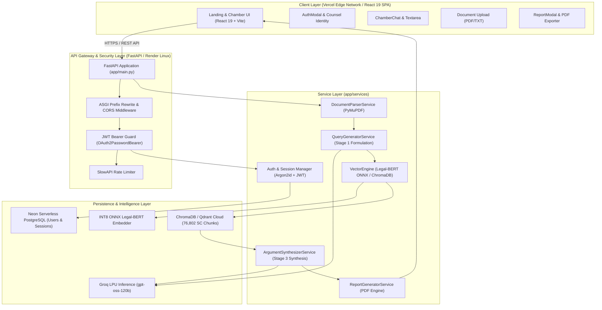
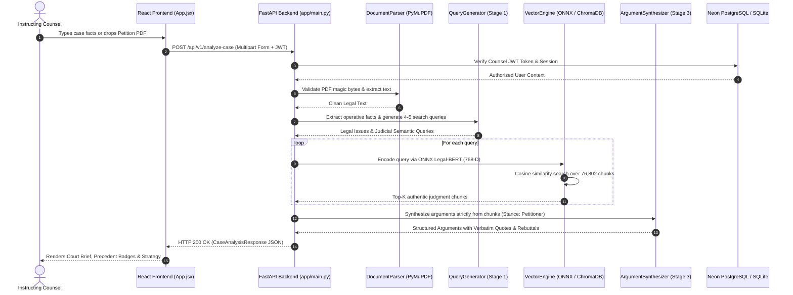

# LAW-AI: Complete System Architecture & Engineering Design
## B.Tech Minor Project Technical Documentation — Chapter 3: System Architecture
**Department of Computer Science & Engineering | GIET University Guidelines Compliant**

---

### 3.1 Overall System Architecture

The LAW-AI platform is engineered as a decoupled, multi-tier microservices architecture combining a responsive client Single Page Application (SPA), a high-performance asynchronous API gateway, a hybrid vector search subsystem, and a domain-specialized anti-hallucinatory LLM pipeline.



---

### 3.2 Complete Workspace Folder & File Structure

```text
D:\PrescendenceRAG\
├── app/                                    # Core Backend Application Package
│   ├── api/                                # API Route Controllers & Endpoints
│   │   ├── __init__.py                     # Package initializer
│   │   ├── auth_routes.py                  # JWT register, login, refresh, verify endpoints
│   │   └── routes.py                       # Core legal endpoints: /analyze-case, /chat, /generate-report
│   ├── model_assets/                       # Optimized Neural Inference Model Assets
│   │   ├── legal_bert_int8.onnx            # Decompressed INT8 ONNX Legal-BERT model
│   │   ├── legal_bert_int8.onnx.gz         # Compressed INT8 ONNX model asset (63.9 MB)
│   │   ├── special_tokens_map.json         # Tokenizer special tokens specification
│   │   ├── tokenizer_config.json           # Fast WordPiece tokenizer configuration
│   │   └── vocab.txt                       # 30,522 legal domain vocabulary tokens
│   ├── services/                           # Business Logic & NLP Processing Pipeline
│   │   ├── __init__.py                     # Package initializer
│   │   ├── argument_synthesizer.py         # Stage 3: Ratio decidendi argument formulation
│   │   ├── chat_session.py                 # Multi-turn consultation engine & domain keyword filters
│   │   ├── document_parser.py              # PyMuPDF parser enforcing 10MB limit & PDF magic bytes
│   │   ├── email_service.py                # Brevo transactional email dispatch & verification
│   │   ├── groq_service.py                 # Groq client with multi-model fallback & JSON extraction
│   │   ├── query_generator.py              # Stage 1: Fact extraction & judicial query formulation
│   │   ├── report_generator.py             # Formal strategy brief synthesis & PDF engine
│   │   └── vector_engine.py                # Hybrid Legal-BERT & ChromaDB/Qdrant vector engine
│   ├── config.py                           # Pydantic Settings & environment variables schema
│   ├── database.py                         # Asynchronous SQLAlchemy database engine & session maker
│   ├── main.py                             # FastAPI factory, lifespan manager, and CORS middleware
│   ├── models.py                           # SQLAlchemy ORM entities (User, Session, Consultation)
│   ├── schemas.py                          # Pydantic v2 validation contracts for API requests/responses
│   └── __init__.py                         # Application package root
├── DATA/                                   # Supreme Court 5-Year Knowledge Base (76,802 chunks)
│   ├── chroma_vector_db/                   # Persistent local ChromaDB collection files
│   ├── chunked_database/                   # Pre-split judgment text segments (.jsonl, .parquet)
│   ├── embeddings_database/                # Raw vector arrays (.npy, .parquet)
│   └── legal_bert_model/                   # PyTorch weights for local sentence-transformers fallback
├── frontend/                               # Client Application (React 19 + Vite 6)
│   ├── public/                             # Static public assets
│   │   ├── courtroom_reference.jpg         # Authentic courtroom photographic reference
│   │   ├── favicon.svg                     # Scales of justice application favicon
│   │   ├── icons.svg                       # SVG symbol definitions
│   │   ├── sunlit_empty_courtroom.png      # High-resolution courtroom canvas backdrop
│   │   └── _redirects                      # SPA routing rewrite rule for static hosting
│   ├── src/                                # Frontend Source Code
│   │   ├── assets/                         # Bundled images and icons
│   │   │   ├── hero.png                    # Hero section illustration
│   │   │   ├── logo.png                    # LAW-AI brand mark
│   │   │   └── sunlit_empty_courtroom.png  # Bundled backdrop graphic
│   │   ├── components/                     # Reusable React UI Components
│   │   │   ├── ui/                         # Atomic animation and reveal components
│   │   │   │   ├── skiper-ui/              # Dynamic double-stairs preloader components
│   │   │   │   └── ScrollRevealWrapper.jsx # Directional scroll-reveal motion container
│   │   │   ├── AuthModal.jsx               # Dual-tab counsel authentication modal
│   │   │   ├── ChamberChat.jsx             # Conversational workspace & message stream
│   │   │   ├── ChamberHeader.jsx           # Minimalist header with stance selector & user badge
│   │   │   ├── ChamberSidebar.jsx          # Session history, statutes, & precedent pool drawer
│   │   │   ├── ChunkModal.jsx              # Full-text precedent excerpt inspector
│   │   │   ├── ErrorBoundary.jsx           # React UI crash shield and recovery handler
│   │   │   ├── LandingExhibition.jsx       # Four architectural pillars showcase
│   │   │   ├── LandingFooter.jsx           # Monolithic colophon footer
│   │   │   ├── LandingHero.jsx             # Above-the-fold luxury serif hero with ghost CTAs
│   │   │   ├── LandingPrecedentsShowcase.jsx# Landmark cases interactive exhibit gallery
│   │   │   ├── ModoNavbar.jsx              # Floating navigation bar with view toggle
│   │   │   ├── ReportModal.jsx             # Formal strategy report modal with PDF download
│   │   │   └── SunlitCourtroomScene.jsx    # Procedural canvas simulation of sunbeams & dust motes
│   │   ├── services/                       # Client API Communication Layer
│   │   │   └── api.js                      # Axios instance with interceptors, token refresh, and endpoints
│   │   ├── App.jsx                         # Main application component & global state coordinator
│   │   ├── index.css                       # Hallmark v2 luxury theme palette and Tailwind directives
│   │   └── main.jsx                        # React root entrypoint mounting StrictMode
│   ├── .env.example                        # Frontend environment variables template
│   ├── index.html                          # HTML5 shell loading Playfair Display & Inter fonts
│   ├── package.json                        # Frontend dependencies & scripts
│   ├── vercel.json                         # Vercel deployment rewrite rules
│   └── vite.config.js                      # Vite bundler configuration with Tailwind v4 plugin
├── tests/                                  # Automated Test Suites
│   ├── stress_test_results.json            # Automated stress testing telemetry output
│   ├── stress_test_suite.py                # 16-scenario end-to-end stress & boundary test harness
│   └── test_api.py                         # Pytest test suite for health, search, chat, & report
├── PRODUCTLENS_REPORT_MATERIALS/           # Final B.Tech Minor Project Report Deliverable Package
│   ├── screenshots/                        # Genuine browser screenshots of all milestones
│   └── test-results/                       # Actual test execution output and metrics
├── cli_test.py                             # Interactive CLI testing harness for legal propositions
├── discover_bundle.py                      # Diagnostic script inspecting DATA/ vector database chunks
├── requirements.txt                        # Production Python dependencies (FastAPI, ONNX, SQLAlchemy)
├── requirements-local.txt                  # Local development dependencies (PyTorch sentence-transformers)
└── vercel.json                             # Root Vercel configuration
```

---

### 3.3 Purpose of Key Files & Core Modules

#### Backend Files
1. **`app/main.py`:**  
   The FastAPI application factory. Registers the custom `ASGIPathRewriteMiddleware` (which automatically maps legacy `/auth/*` calls to `/api/v1/auth/*`), configures CORS with credentials for client origins, attaches the SlowAPI rate limiter, and implements the asynchronous `lifespan` handler that loads database schemas and pre-initializes the 76,802 vector engine.
2. **`app/config.py`:**  
   Centralized type-safe settings management using Pydantic Settings. Handles environment variables for database URLs, JWT encryption keys, Groq API configurations, vector engine toggles (`local` vs. `qdrant`), and Brevo email credentials.
3. **`app/database.py`:**  
   Manages the SQLAlchemy 2.0 asynchronous connection pool. Supports both serverless cloud PostgreSQL (Neon via `asyncpg`) and local SQLite (via `aiosqlite`), exposing the async session dependency `get_db`.
4. **`app/models.py`:**  
   Declarative ORM entity models representing users (`User`), cryptographic refresh sessions (`RefreshSession`), verification tokens (`EmailVerificationToken`), password reset tokens (`PasswordResetToken`), and persistent chat consultation sessions (`ChatConsultation`).
5. **`app/schemas.py`:**  
   Pydantic v2 data transfer objects (DTOs) defining strict contracts for requests (`CaseAnalysisRequest`, `ChatMessageRequest`, `ReportGenerationRequest`, `UserRegisterRequest`) and structured responses (`CaseAnalysisResponse`, `LegalReportResponse`, `TokenResponse`).
6. **`app/services/vector_engine.py`:**  
   The foundational semantic search service. Employs a singleton pattern to maintain the active vector engine. In cloud mode, executes an optimized INT8-quantized ONNX Legal-BERT model in ~18ms over standard CPU architecture, querying against Qdrant Cloud or local ChromaDB collections.
7. **`app/services/query_generator.py`:**  
   Stage 1 NLP parser. Extracts legally operative factual matrices and reformulates unstructured case narratives into 4–5 targeted judicial search queries embedded with dense Supreme Court legal terminology.
8. **`app/services/argument_synthesizer.py`:**  
   Stage 3 legal reasoning engine. Feeds retrieved judgment chunks and the user's selected stance (*Petitioner* vs. *Respondent*) into Groq's high-speed inference engine (`openai/gpt-oss-120b`). Strictly enforces anti-hallucination by requiring verbatim excerpts and predicting opposing counsel's oral counter-arguments.
9. **`app/services/document_parser.py`:**  
   Multi-page legal document ingestion module. Uses `PyMuPDF` to parse PDF and TXT petitions up to 10 MB, verifying authentic `%PDF-` file headers to prevent malicious payloads.
10. **`app/services/report_generator.py`:**  
    Document automation engine that synthesizes full case strategy briefs into structured JSON, HTML, and high-resolution downloadable PDF files.

#### Frontend Files
1. **`frontend/src/App.jsx`:**  
   The root React component coordinating global application state: active view (`landing` vs. `chamber`), authenticated user profile (`currentUser`), active consultation messages, and modal visibility states.
2. **`frontend/src/services/api.js`:**  
   The Axios HTTP communication layer. Configures request interceptors to automatically append JWT Bearer tokens and response interceptors to execute transparent token refreshing on HTTP 401 status codes.
3. **`frontend/src/components/ChamberChat.jsx`:**  
   The primary consultation workspace. Features an auto-expanding input textarea, file upload trigger, conversational message stream with markdown formatting, citation cards, and real-time generation indicators.
4. **`frontend/src/components/ReportModal.jsx`:**  
   Modal interface presenting the generated Supreme Court Strategy Report, complete with executive brief, formatted ratio decidendi arguments, table of authorities, and a direct PDF download trigger.
5. **`frontend/src/components/SunlitCourtroomScene.jsx`:**  
   High-performance HTML5 Canvas component that procedurally renders dynamic sunbeams (God rays) and floating dust motes bounded strictly within window-to-table polygon coordinates.

---

### 3.4 Data Flow & Communication Architecture



---

### 3.5 Authentication & Data Persistence Mechanisms

1. **Authentication Flow (Stateless JWT + Stateful Cryptographic Refresh):**
   - **Access Token:** Short-lived (15 minutes) HMAC-SHA256 JWT containing `sub` (User UUID) and `email`. Stored client-side in `localStorage` and dispatched in the `Authorization: Bearer <token>` header.
   - **Refresh Token:** Long-lived (7 days) high-entropy cryptographic string generated via `secrets.token_urlsafe(48)`. Only the SHA-256 hash is persisted in the `refresh_sessions` table. Dispatched as an HTTP-only secure cookie or refresh body.
   - **Auto-Refresh Interceptor:** If an API call receives HTTP 401, Axios intercepts the error, calls `/auth/refresh` behind the scenes, stores the new token, and replays the original failed request seamlessly.
2. **Password Security:**
   - Client passwords are never stored in plaintext. They are hashed using **Argon2id** (via `pwdlib` and `argon2-cffi`), providing high resistance to GPU-accelerated brute-force and rainbow table attacks.
3. **Session Persistence:**
   - Multi-turn case consultations, chat histories, active case context, and selected stances are saved in the `chat_consultations` table in Neon PostgreSQL. Advocates can reload prior case consultations across different browsers or login sessions.
