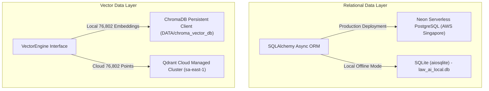

# LAW-AI: Technology Stack & Dependency Architecture
## B.Tech Minor Project Technical Documentation — Chapter 2: Technology Stack
**Department of Computer Science & Engineering | GIET University Guidelines Compliant**

---

### 2.1 Technology Stack Summary Table

| Category | Primary Technology / Library | Version | Role in Architecture |
| :--- | :--- | :--- | :--- |
| **Frontend Framework** | React | `^19.0.0` | Declarative component UI library powering the Single Page Application (SPA). |
| **DOM Renderer** | React DOM | `^19.0.0` | Package providing DOM-specific methods for client-side rendering. |
| **Build Engine & Bundler** | Vite | `^6.1.0` | Ultra-fast ESM-native frontend build tool and Hot Module Replacement (HMR) server. |
| **CSS Framework** | Tailwind CSS | `^4.0.0` | Utility-first styling engine with `@tailwindcss/vite` integration. |
| **Animation Engine** | Framer Motion | `^12.4.7` | Production-ready motion library for spring physics, layout animations, and transitions. |
| **Iconography** | Lucide React | `^0.475.0` | Comprehensive SVG icon system for clean judicial UI navigation. |
| **Markdown Rendering** | React Markdown | `^9.0.3` | Parses and renders structured judicial markdown output. |
| **GFM Extension** | Remark GFM | `^4.0.0` | Enables GitHub Flavored Markdown support (legal tables, task lists, strikethrough). |
| **HTTP Client** | Axios | `^1.7.9` | Promise-based asynchronous HTTP client with Bearer token interceptors. |
| **Frontend Linter** | Oxlint | `^0.15.10` | High-performance Rust-based JavaScript/JSX static analysis tool. |
| **Backend Framework** | FastAPI | `>=0.115.0` | High-performance asynchronous Python web framework built on Starlette and Pydantic. |
| **ASGI Web Server** | Uvicorn | `>=0.30.0` | Lightning-fast ASGI web server implementation using uvloop and httptools. |
| **Data Validation** | Pydantic | `>=2.8.0` | Data validation and settings management using Python type hints with Rust core. |
| **Settings Management** | Pydantic Settings | `>=2.4.0` | Environment variable parsing and `.env` configuration file loader. |
| **Email Validator** | Email-Validator | `>=2.2.0` | Robust RFC 5322 email syntax and deliverability validation library. |
| **Multipart Parsing** | Python-Multipart | `>=0.0.9` | Streaming multipart/form-data parser for legal petition PDF/TXT file uploads. |
| **Document Extraction** | PyMuPDF (`fitz`) | `>=1.24.0` | High-performance PDF parser for text extraction, metadata, and token sanitization. |
| **AI Inference Provider** | Groq Python SDK | `>=0.11.0` | Ultra-low latency LPU (Language Processing Unit) inference client. |
| **Vector Database (Local)** | ChromaDB | `>=0.5.0` | Local embedded vector database hosting 76,802 Supreme Court embeddings. |
| **Vector Database (Cloud)** | Qdrant Client | `>=1.11.0` | Official client for Qdrant Cloud vector search engine. |
| **ONNX Runtime** | ONNX Runtime | `>=1.19.0` | High-performance CPU cross-platform engine for INT8 quantized neural model execution. |
| **Transformers** | HuggingFace Transformers | `>=4.40.0` | Tokenization pipeline using `BertTokenizerFast` for Legal-BERT. |
| **Numerical Arrays** | NumPy | `>=1.24.0` | Array manipulation for embedding tensor normalization and cosine similarity math. |
| **Object-Relational Mapping** | SQLAlchemy (Asyncio) | `>=2.0.30` | Asynchronous ORM with unit-of-work patterns for relational data persistence. |
| **SQLite Async Driver** | aiosqlite | `>=0.20.0` | Asyncio bridge for local SQLite database storage (`law_ai_local.db`). |
| **PostgreSQL Async Driver** | asyncpg / psycopg | `>=0.29.0` | High-throughput asynchronous driver connecting to Neon Serverless PostgreSQL. |
| **Database Migrations** | Alembic | `>=1.13.0` | Lightweight schema migration tool for SQLAlchemy models. |
| **Authentication & Tokens** | PyJWT | `>=2.9.0` | JSON Web Token implementation for RFC 7519 access token generation. |
| **Password Hashing** | Pwdlib + Argon2-cffi | `>=0.2.0` | Memory-hard Argon2id password hashing compliant with OWASP standards. |
| **Rate Limiting** | SlowAPI | `>=0.1.9` | Token bucket rate limiting engine integrated with Starlette middleware. |
| **Unit & Integration Testing** | Pytest + Pytest-Asyncio | `>=8.0.0` | Modern Python test framework supporting asynchronous test fixtures and assertions. |

---

### 2.2 Programming Languages
* **Python (v3.12.9):** Core backend language powering the FastAPI server, vector indexing, neural inference, and RAG pipelines.
* **JavaScript (ECMAScript 2026 / JSX):** Primary frontend language for React components, visual layout, and browser interaction.
* **SQL:** Relational database querying executed via SQLAlchemy async ORM against PostgreSQL and SQLite.
* **HTML5 Canvas API:** Procedural 2D graphics rendering for the dynamic courtroom volumetric God-ray and airborne particle motes simulation.
* **CSS3:** Responsive layout, glassmorphic filters, and typography styling configured through Tailwind CSS v4.

---

### 2.3 AI & Machine Learning Models

#### 2.3.1 Domain-Specific Embedding Model: Legal-BERT
* **Model Identifier:** `nlpaueb/legal-bert-base-uncased`
* **Architecture:** 12-layer, 768-hidden dimension, 12-attention heads, 110M parameters pretrained on legal domain corpora (legislation, court cases, contracts).
* **Optimization / Deployment:**
  - *Local Mode:* Standard Hugging Face PyTorch weights pre-loaded in memory from `DATA/legal_bert_model/` using `sentence-transformers`.
  - *Cloud / Edge Mode (INT8 Quantization):* Converted to ONNX format and quantized to INT8 (`app/model_assets/legal_bert_int8.onnx.gz`, 63.9 MB). Decompresses dynamically on boot, achieving ~18ms latency and ~120MB memory consumption on standard CPUs.

#### 2.3.2 Reasoning & Argument Synthesizer LLM
* **Primary Model:** `openai/gpt-oss-120b` via Groq LPU Inference Engine.
* **Fallback Model 1:** `openai/gpt-oss-20b` (low-latency fallback for high-throughput consultation turns).
* **Fallback Model 2:** `llama-3.3-70b-versatile` (ensures high availability when primary models face upstream rate limits).
* **Offline Vector & Heuristic Engine:** When no external API key is present or connectivity is unavailable, LAW-AI automatically engages its built-in rule-based heuristic generator, producing structured precedent briefs directly from retrieved chunks without runtime failures.

---

### 2.4 Database & Storage Technologies

1. **Relational Database (User & Consultations):**
   - **Production Engine:** Neon Serverless PostgreSQL hosted on AWS Singapore (`ep-fragrant-night-ao0ghxxc-pooler.c-2.ap-southeast-1.aws.neon.tech/neondb?ssl=require`).
   - **Local Development Engine:** Asynchronous SQLite file-based database (`law_ai_local.db`).
   - **Stored Entities:** User credentials, Argon2 password hashes, Google OAuth subjects, verification tokens, refresh sessions, and saved multi-turn consultation transcripts.
2. **Vector Database (Precedent Knowledge Base):**
   - **Local Engine:** ChromaDB (`PersistentClient` pointing to `DATA/chroma_vector_db`) containing 76,802 chunks indexed with Cosine distance.
   - **Cloud Engine:** Qdrant Cloud instance containing 76,802 vectors (`supreme_court_cases_last_5yrs_legalbert`).

---

### 2.5 External Services & Development Environment

* **External APIs:**
  - **Groq Cloud API:** High-throughput LLM reasoning engine via `https://api.groq.com/openai/v1`.
  - **Brevo API (formerly Sendinblue):** Transactional email dispatch for counsel account verification.
  - **Google OAuth 2.0:** Counsel federated Single Sign-On (SSO).
  - **Qdrant Cloud API:** Hosted vector store managed endpoint.
* **Development & Deployment Environment:**
  - **Local Host:** Windows 11 Enterprise (x64), PowerShell 7+, Node.js v25.6.1, Python 3.12.9.
  - **Frontend Deployment:** Vercel Global Edge Network (`https://law-rag-ai.vercel.app/`).
  - **Backend Deployment:** Render Cloud Linux Environment (`https://law-ai-ts2x.onrender.com`).
